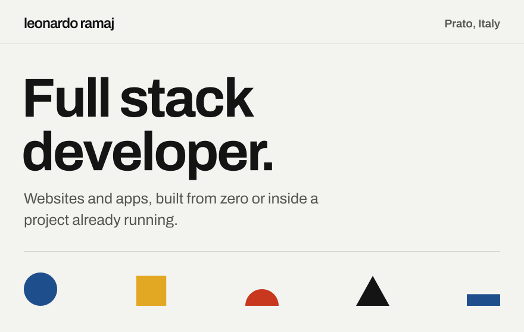
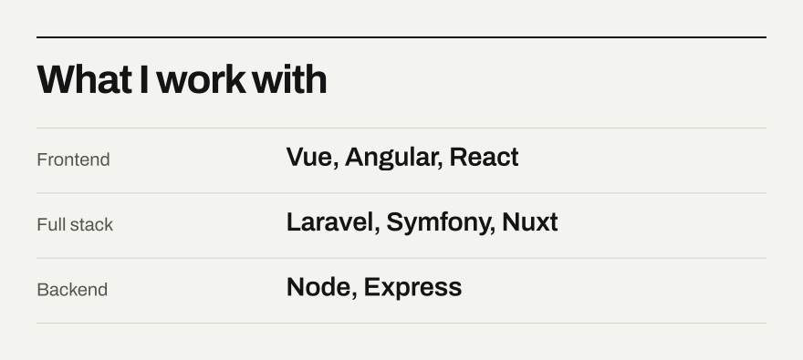
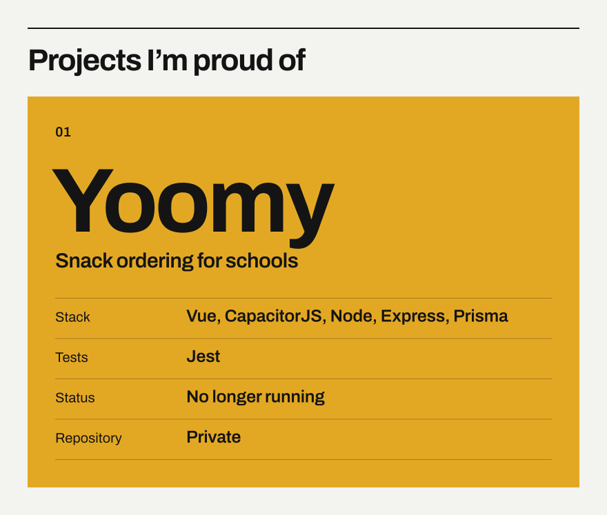
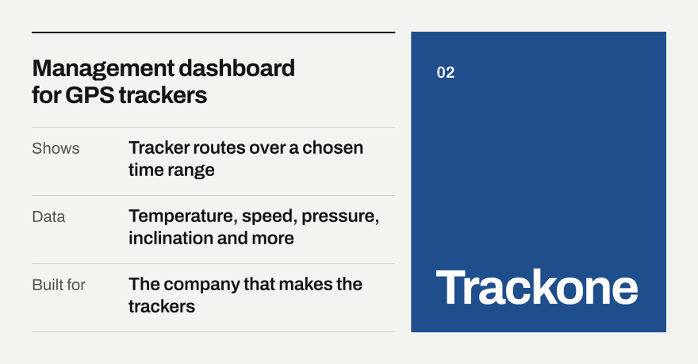
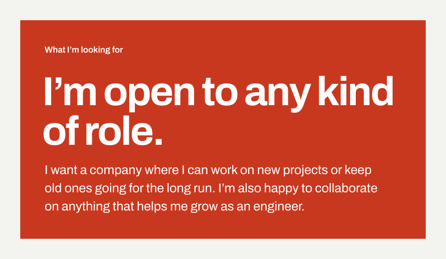
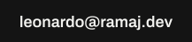
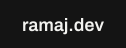
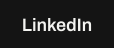
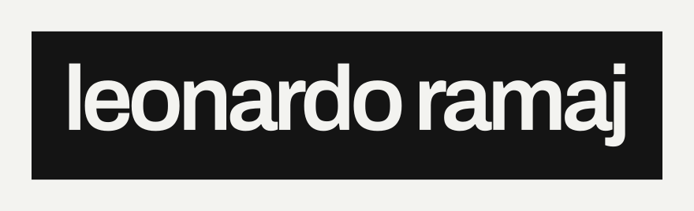

  <picture>
    <source media="(prefers-color-scheme: dark)" srcset="assets/dark/header.svg">
    
  </picture>

I'm a 25-year-old freelance developer from Prato, Italy. I've been building software for clients for about five years now, and I still like it as much as when I started. Coding is my hobby as well as my job. When I'm not at the keyboard I'm usually playing basketball or losing to a very hard video game.

  <picture>
    <source media="(prefers-color-scheme: dark)" srcset="assets/dark/work.svg">
    
  </picture>

I'm always eager to learn something new.

I also use AI as part of my daily workflow to deliver better software. It speeds up the repetitive parts and gives me a second opinion on my code, and I still review everything before it ships.

  <picture>
    <source media="(prefers-color-scheme: dark)" srcset="assets/dark/yoomy.svg">
    
  </picture>

Yoomy was a platform where students could order their snack at school online. The idea was to bring something like Just Eat into schools. I used it for my degree thesis, where I wrote the tests with Jest. It isn't running anymore and the repository is private, but you can find it at [App-Food-Delivery/yoomy_app](https://github.com/App-Food-Delivery/yoomy_app).

  <picture>
    <source media="(prefers-color-scheme: dark)" srcset="assets/dark/trackone.svg">
    
  </picture>

Trackone is a management dashboard for GPS trackers, built for the company that makes them. You pick a time range and see the route a tracker took, along with the data it collected: temperature, speed, pressure, inclination and more.

  <picture>
    <source media="(prefers-color-scheme: dark)" srcset="assets/dark/contact.svg">
    
  </picture>

  <a href="mailto:leonardo@ramaj.dev"><picture><source media="(prefers-color-scheme: dark)" srcset="assets/dark/btn-email.svg"></picture></a>&nbsp;&nbsp;
  <a href="https://ramaj.dev"><picture><source media="(prefers-color-scheme: dark)" srcset="assets/dark/btn-site.svg"></picture></a>&nbsp;&nbsp;
  <a href="https://www.linkedin.com/in/leonardo-ramaj-7a304120a/"><picture><source media="(prefers-color-scheme: dark)" srcset="assets/dark/btn-linkedin.svg"></picture></a>

  <picture>
    <source media="(prefers-color-scheme: dark)" srcset="assets/dark/footer.svg">
    
  </picture>

